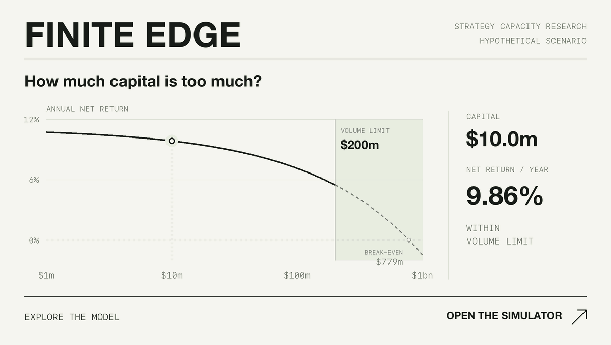

<a href="https://patrickbateman-g.github.io/finite-edge/">
  <picture>
    <source media="(prefers-reduced-motion: reduce)" srcset="assets/finite-edge-preview.png">
    
  </picture>
</a>

**[OPEN THE SIMULATOR ↗](https://patrickbateman-g.github.io/finite-edge/)** &nbsp; · &nbsp; [Research notebook](capacity_research.ipynb) &nbsp; · &nbsp; [Results](dist/research.json)

<sub>Animated model preview · click the graphic to change the assumptions.</sub>

---

# When does a trading edge stop scaling?

Finite Edge connects an interactive execution-cost model to a reproducible, chronological machine-learning experiment.

The included ridge model does **not** demonstrate a profitable edge. The contribution is an auditable path from observations to predictions, costs, uncertainty and a capital-allocation decision. A convincing interface cannot turn a failed forecast into alpha.

## What is inside

- An analytical capacity model with a break-even point, participation constraint and constrained dollar-profit optimum.
- Training-only transformations and expanding-window historical evaluation.
- Frozen baseline comparisons, regularization diagnostics, feature ablations, fold-level results and block-bootstrap uncertainty.
- Explicit separation of hypothetical capacity scenarios from observed model results.
- Python standard-library research code and a static browser application with no external runtime packages, fonts or tracking scripts.

## Reproduce

From the project directory, with Python 3.10 or later:

```sh
python3 research.py
python3 prepare_pages.py
python3 -m unittest discover -s tests -v
python3 -m http.server 8765 --directory dist
```

Open `http://localhost:8765`. You can also open `dist/index.html` directly: precomputed results are bundled in `research-data.js`. Regeneration is deterministic and uses the included small CSV; no account or network request is required.

An optional JavaScript/Python formula-parity check requires Node.js:

```sh
node tests/check_browser_math.cjs
```

The notebook is a guided companion. The scripts do not require Jupyter; use an existing compatible notebook environment to inspect it interactively.

## Research protocol

Data: Plotly's [506-session AAPL educational sample](https://github.com/plotly/datasets/blob/master/finance-charts-apple.csv), covering 2015–2017. Its SHA-256 is stored in the result. Precomputed indicator columns are ignored; features are rebuilt from OHLCV observations.

Six features observed at close *t* predict the next session's open-to-close return: one-day return, five- and twenty-day momentum, twenty-day volatility, intraday range and relative volume. Momentum and volatility use adjusted closes; the target uses raw open/close; dollar volume uses raw close × share volume. Historical adjustment metadata is unavailable, so this is not a point-in-time institutional dataset.

| Stage | Observations | Target dates | Decision |
| --- | ---: | --- | --- |
| Initial training | 240 | 2015-03-19 – 2016-03-01 | Fit transformations and coefficients |
| Chronological validation | 80 | 2016-03-02 – 2016-06-23 | Select ridge penalty by MSE |
| Walk-forward evaluation | 164 | 2016-06-24 – 2017-02-16 | Freeze penalty; refit every 20 sessions |

The selected penalty is 100, the upper edge of the preset grid `[0.001, 0.01, 0.1, 1, 10, 100]`. It supports heavy shrinkage within this grid, not a globally optimal penalty. Each refit uses only observed labels and fits its scaler from those training observations. There is no random split.

The final period is **out of sample for each prediction**, but the expanded diagnostics were designed after the original evaluation was inspected. This is an exploratory audit, not a preregistered, untouched confirmatory test. Choosing a model from these results would require a new independent evaluation.

### Forecasts, positions and costs

The comparison includes zero-return forecasts, an expanding training-label mean, a deterministic five-day momentum heuristic and ridge. All nonzero forecasts use the same position rule:

```text
position = clip(prediction / 0.01, -1, 1)
gross_return = position × next_session_open_to_close_return
daily_turnover = 2 × abs(position)
net_before_impact = gross_return − daily_turnover × one_way_cost_bps / 10,000
```

Positions open and close within one session. Both legs pay costs. The reference cost is 3.5 basis points per side: half a 5 bp full quoted spread plus a 1 bp fee. This is an assumption, not an observed historical spread. Cost sensitivity varies it. The common position rule does not equalize risk or exposure, so P&L comparisons are descriptive; no test-period winner is selected. Borrow availability, borrow fees, financing and auction execution are not modeled.

Ridge has zero-benchmark out-of-sample R² of approximately **−0.00643**, annual arithmetic gross return **−0.52%**, and annual return after reference fixed costs **−0.87%**, before impact. A zero forecast has lower squared error. The result does not support deployment; nonpositive gross return implies zero positive capacity under nonnegative costs.

### Diagnostics and uncertainty

The regularization path reports training and validation errors. Leave-one-feature-out ablations keep the full-model penalty fixed and use the same refits. They are predictive sensitivity checks, not causal attribution. Fold summaries expose variation across nine evaluation batches, including the shorter final batch.

Uncertainty uses paired daily observations resampled in circular moving blocks: 2,000 draws, seed 1729, five-session primary blocks and sensitivity at one and ten sessions. The 95% percentile intervals summarize annualized net return and zero-benchmark R² conditional on the realized forecast path. They exclude refitting and model-selection uncertainty, survivorship bias and unknown future regimes. A confidence interval is not the probability that an edge exists.

## Which Stanford CS229 methods are used?

These references are the Stanford-hosted cheatsheets by **Afshine Amidi and Shervine Amidi**: [Supervised Learning](https://web.stanford.edu/~shervine/teaching/cs-229/cheatsheet-supervised-learning/) and [Machine Learning Tips and Tricks](https://web.stanford.edu/~shervine/teaching/cs-229/cheatsheet-machine-learning-tips-and-tricks/). They supply educational terminology; this project has no Stanford affiliation or endorsement.

| Cheatsheet concept | Implementation here | Boundary |
| --- | --- | --- |
| Linear regression; squared-error loss | Continuous return forecast with a squared-error objective | No classification |
| Normal equations | Regularized linear system solved by Gauss–Jordan elimination | No gradient descent |
| Ridge / L2 regularization | Penalize standardized feature coefficients; exempt intercept | No LASSO or elastic net |
| Training, validation, testing | Chronological 240 / 80 / 164 split | Expanding refits replace random k-fold CV |
| Regression error and R² | MSE and skill against zero-return forecasts | Our R² denominator is Σy², not the sheet's mean-centered Σ(y−ȳ)² |
| Bias/variance diagnostics | Inspect training/validation errors across penalties | Not a measured bias/variance decomposition |
| Error and ablative analysis | Baselines, fold summaries and feature removal | Exploratory; not causal |

Training-only standardization, temporal leakage checks, moving-block resampling and execution capacity are additional implementation choices, not direct implementations of these two sheets. Neural networks, reinforcement learning, SVMs, random forests, boosting, clustering and PCA are not used.

## Capacity model and units

The calculator asks a conditional question: **if** a strategy has the entered edge and trading characteristics, how much capital could the assumptions support? Positive-alpha scenarios are illustrative inputs, not estimates from the failed AAPL model.

| Symbol | Meaning |
| --- | --- |
| A | Constant capital / NAV, USD |
| t | Daily gross traded notional / NAV, counting buys and sells |
| n | Equally liquid, equally sized instruments |
| V | Daily dollar volume per instrument |
| σ | Daily return volatility |
| Y | Square-root impact coefficient |
| p | Maximum aggregate daily participation |
| s, f | Full quoted spread and one-way fee, basis points |
| T, h | Execution window and signal half-life, trading days |

```text
daily_notional_per_name = A t / n
delayed_alpha = alpha × 2^(−(T−1)/(2h))
fixed_cost = 252 t (s/2 + f) / 10,000
k = 252 t Y σ sqrt(t/(nV))
annual_net_return(A) = delayed_alpha − fixed_cost − k sqrt(A)
```

Let `b = delayed_alpha − fixed_cost`. For `b > 0`, break-even capital is `(b/k)²`; otherwise positive capacity is zero. The participation cap is `p n V/t`; usable capacity is the smaller of these two values. Maximizing constant-NAV annual dollar profit `A × (b − k sqrt(A))` gives `4/9` of break-even capital, clipped by the participation cap.

The square-root term is an illustrative heuristic, not an empirically fitted execution model. Continuous daily orders overlap, so longer execution does not divide aggregate steady-state participation by the number of days. The window changes assumed signal delay only. Decay is evaluated at the mean delay `(T−1)/2`; this approximates, rather than exactly integrates, decay over uniformly distributed fills. Beyond the participation limit, the curve is an infeasible extrapolation.

The calculator uses average conditions and equal instrument liquidity. Real capacity requires per-instrument holdings, executable volumes, spreads, calibrated impact, risk constraints and adverse-selection analysis. Annual returns and dollar profit use arithmetic annualization at 252 sessions, not CAGR. Any compounded drawdown is separately labeled. The ML preset averages its inputs; it is not a per-session replay of nonlinear impact costs.

## Repository map

```text
engine.py                   Capacity equations and input validation
research.py                 Deterministic historical research pipeline
package_source.py           Portable source ZIP, excluding host metadata
prepare_pages.py            Refresh source download and GitHub Pages output
capacity_research.ipynb      Guided replication and interpretation
data/apple.csv              Small, fixed educational input
tests/                      Invariants, temporal checks and browser parity
dist/                       Static site and generated results
docs/                       GitHub Pages publication directory
```

## Share on a CV or GitHub

The live research link above is the portfolio demo. A defensible CV description:

> Built a reproducible strategy-capacity research tool combining analytical market-impact constraints, chronological ridge evaluation, baseline comparisons and block-bootstrap uncertainty; documented a negative out-of-sample result and tested model invariants.

The source repository is [Patrickbateman-g/finite-edge](https://github.com/Patrickbateman-g/finite-edge). The live demo uses GitHub Pages at the link above.

To refresh the website after source or research changes:

```sh
python3 research.py
python3 prepare_pages.py
```

Commit the updated source, `dist/` and `docs/`. GitHub Pages is configured with **Settings → Pages → Deploy from a branch → main → /docs**. `prepare_pages.py` builds the downloadable source package and copies the static files to `docs/`, including `.nojekyll`. Relative asset paths support the `/finite-edge/` repository subpath. See [GitHub's publishing-source documentation](https://docs.github.com/en/pages/getting-started-with-github-pages/configuring-a-publishing-source-for-your-github-pages-site).

## References and provenance

- [Plotly datasets](https://github.com/plotly/datasets/blob/master/finance-charts-apple.csv): historical OHLCV example; original data conventions remain a limitation.
- [Amidi & Amidi, CS229 Supervised Learning](https://web.stanford.edu/~shervine/teaching/cs-229/cheatsheet-supervised-learning/) and [Tips and Tricks](https://web.stanford.edu/~shervine/teaching/cs-229/cheatsheet-machine-learning-tips-and-tricks/): methods mapped above.
- [AQR, Trading Costs](https://www.aqr.com/Insights/Research/Working-Paper/Trading-Costs): execution-cost and capacity motivation.
- [CME, Reassessing Liquidity](https://www.cmegroup.com/articles/2025/reassessing-liquidity-beyond-order-book-depth.html): liquidity/volatility context for illustrative square-root impact.
- [Microsoft Qlib](https://github.com/microsoft/qlib): conceptual inspiration for separating signals and evaluation; no Qlib code is executed.
- [Sequoia No Limit](https://pokerbot.sequoiacap.com/index.html): visual inspiration only; no affiliation with Sequoia, Jane Street or Stanford.

No third-party repository software was installed for this project. No large market dataset was downloaded. The source bundle contains the project only, without account credentials, private repository contents or previous security reports.
